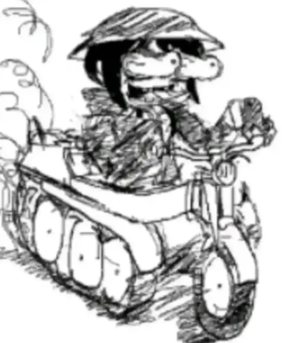
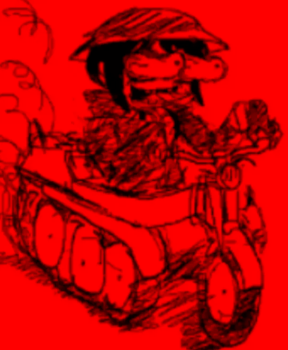
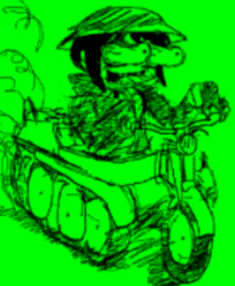
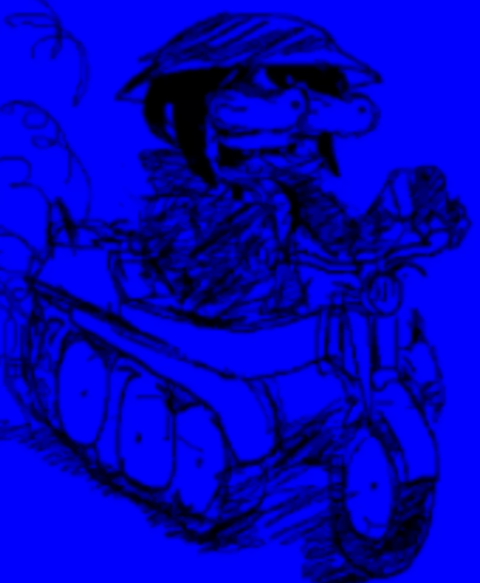
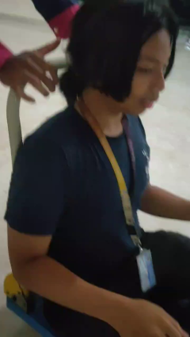
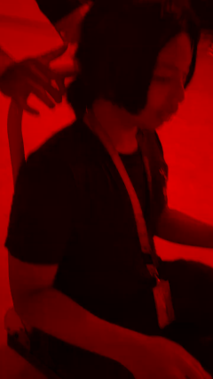
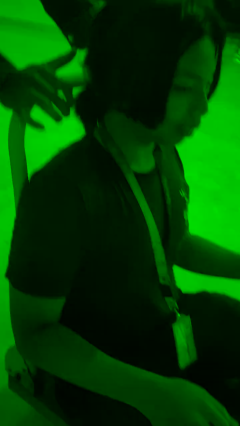
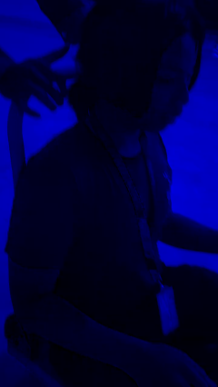

# Tugas 1 - Introduction

Membaca citra, menampilkan citra, lalu menampilkan filter warna merah, hijau, dan biru untuk gambar dan video. Setiap hasil disimpan sebagai gambar terpisah dengan ukuran kecil. Pada video, keempat kanal ditampilkan di jendela masing-masing dan frame pertama disimpan sebagai gambar.

## Kode

```python
import cv2
import numpy as np

def keep_channel(img, channel):
    out = np.zeros_like(img)
    if channel == "original":
        out[:] = img
    elif channel == "blue":
        out[:, :, 0] = img[:, :, 0]
    elif channel == "green":
        out[:, :, 1] = img[:, :, 1]
    elif channel == "red":
        out[:, :, 2] = img[:, :, 2]
    return out
```

Kode di atas hanya bagian pengolahan citra. Bagian pembacaan, penampilan, dan penyimpanan hasil beserta nama file output tidak ditampilkan. Kode lengkap ada di `1-Intro.py`.

## Hasil Filter Gambar

### Original



### Red



### Green



### Blue



## Hasil Filter Video

Frame pertama video setelah difilter per kanal. Tekan `q` untuk menghentikan video.

### Original



### Red



### Green



### Blue


