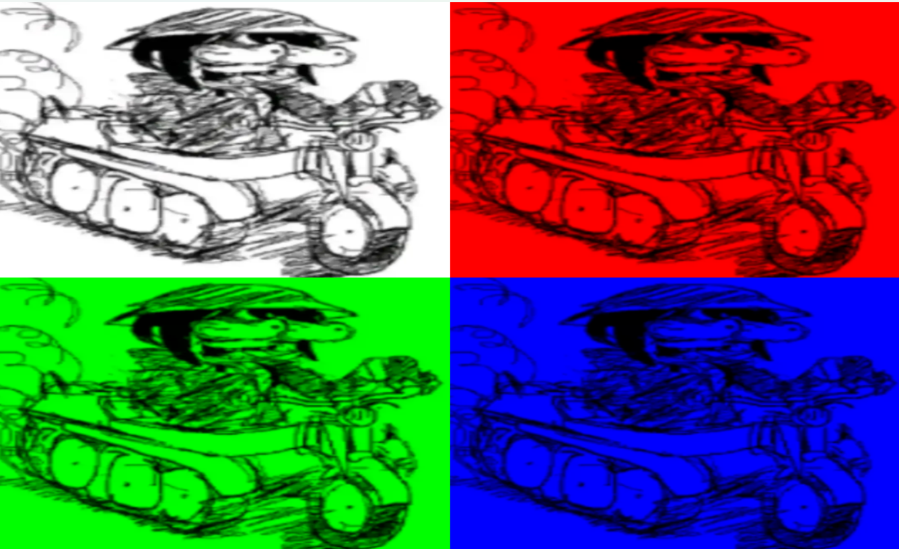
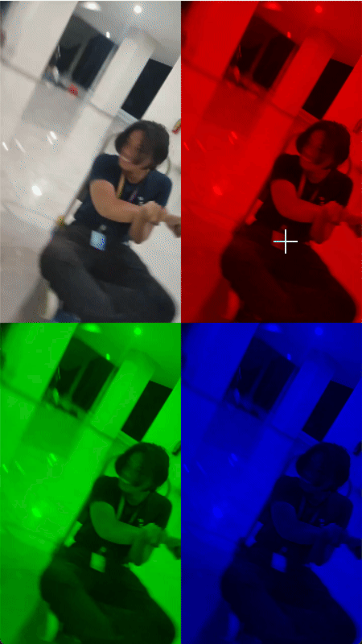

# Tugas 1 - Introduction

## Gambar
Membuat filter warna untuk gambar (Original, R, G, B)

```python
import cv2
import numpy as np

def original(img):
    return img.copy()

def red(img):
    out = img.copy()
    out[:, :, 0] = 0
    out[:, :, 1] = 0
    return out

def green(img):
    out = img.copy()
    out[:, :, 0] = 0
    out[:, :, 2] = 0
    return out

def blue(img):
    out = img.copy()
    out[:, :, 1] = 0
    out[:, :, 2] = 0
    return out

filters = [original, red, green, blue]

img = cv2.imread("t1/crazy.jpeg")

tiles = [fn(img) for fn in filters]

top = np.hstack(tiles[:2])
bottom = np.hstack(tiles[2:])
combined = np.vstack((top, bottom))

h, w = combined.shape[:2]
combined = cv2.resize(combined, (w // 2, h // 4))

cv2.imshow("", combined)
cv2.waitKey(0)
cv2.destroyAllWindows()
```



## Video
Membuat filter warna untuk video (Original, R, G, B)

```python
import cv2
import numpy as np

atha = cv2.VideoCapture("drift.mp4")

while True:
    ret, frame = atha.read()
    if not ret:
        break

    f1 = frame.copy()

    f2 = frame.copy()
    f2[:, :, 0] = 0 
    f2[:, :, 1] = 0 

    f3 = frame.copy()
    f3[:, :, 0] = 0 
    f3[:, :, 2] = 0 

    f4 = frame.copy()
    f4[:, :, 1] = 0
    f4[:, :, 2] = 0

    h, w = frame.shape[:2]
    f1 = cv2.resize(f1, (w//4, h//4))
    f2 = cv2.resize(f2, (w//4, h//4))
    f3 = cv2.resize(f3, (w//4, h//4))
    f4 = cv2.resize(f4, (w//4, h//4))

    top    = np.hstack((f1, f2))
    bottom = np.hstack((f3, f4))
    combined = np.vstack((top, bottom))

    cv2.imshow("video", combined)

    if cv2.waitKey(3) & 0xFF == ord('q'):
        break

atha.release()
cv2.destroyAllWindows()
```

