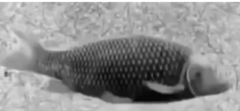
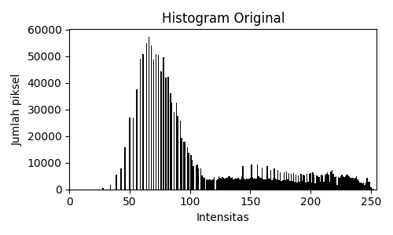
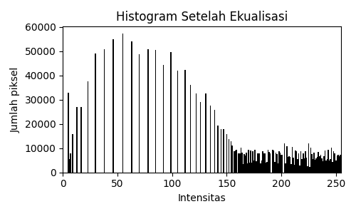
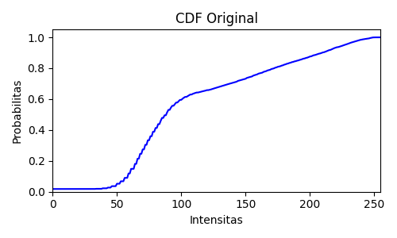
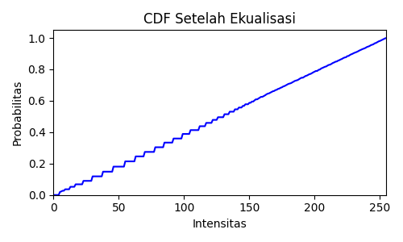

# Tugas 2 - Transformasi Intensitas dan Ekualisasi Histogram

Menerapkan transformasi intensitas (negative, log, gamma, contrast stretching) dan ekualisasi histogram. Histogram, CDF, dan LUT dihitung manual tanpa `cv2.equalizeHist`, `cv2.normalize`, `cv2.LUT`, atau `cv2.calcHist`. Setiap hasil disimpan sebagai gambar kecil terpisah.

## Kode

```python
import cv2
import numpy as np

def histogram(img):
    hist = np.zeros(256, dtype=np.int64)
    for value in img.ravel():
        hist[value] += 1
    return hist

def cumulative(hist):
    cdf = np.zeros(256, dtype=np.int64)
    total = 0
    for k in range(256):
        total += int(hist[k])
        cdf[k] = total
    return cdf

def negative(img):
    return 255 - img

def log_transform(img):
    c = 255.0 / np.log(1.0 + 255.0)
    out = c * np.log(1.0 + img.astype(np.float64))
    return np.clip(out, 0, 255).astype(np.uint8)

def gamma_transform(img, gamma=0.5):
    out = 255.0 * (img.astype(np.float64) / 255.0) ** gamma
    return np.clip(out, 0, 255).astype(np.uint8)

def contrast_stretch(img, hist):
    values = np.flatnonzero(hist)
    rmin, rmax = int(values[0]), int(values[-1])
    if rmax == rmin:
        return img.copy()
    out = (img.astype(np.float64) - rmin) * 255.0 / (rmax - rmin)
    return np.clip(out, 0, 255).astype(np.uint8)

def equalize_histogram(img, hist):
    height, width = img.shape
    total = height * width

    cdf = cumulative(hist)

    lut = np.zeros(256, dtype=np.uint8)
    for k in range(256):
        lut[k] = int(round(255.0 * cdf[k] / total))

    equalized = lut[img]
    return equalized, lut, cdf
```

Kode di atas hanya bagian pengolahan citra. Bagian pembacaan, penampilan, dan penyimpanan hasil beserta nama file output tidak ditampilkan. Kode lengkap ada di `2-ti-eq.py`.

## Transformasi Intensitas

### Original


### Negative



### Log


### Gamma 0.5


### Contrast Stretch


### Histogram Equalization


## Histogram

### Histogram Original



### Histogram Setelah Ekualisasi



### CDF Original



### CDF Setelah Ekualisasi


