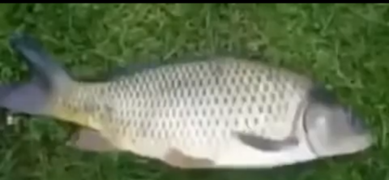
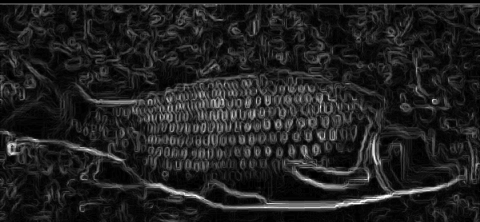
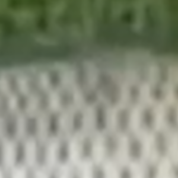
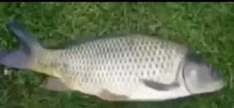

# Tugas 3 - Filter Spasial

Menerapkan filter spasial secara manual tanpa `cv2.filter2D`, `cv2.blur`, `cv2.GaussianBlur`, atau `cv2.medianBlur`. Setiap filter disimpan sebagai gambar kecil terpisah.

## Kode

```python
import cv2
import numpy as np

MEAN_5 = np.ones((5, 5), dtype=np.float32) / 25.0
SHARPEN = np.array([[0, -1, 0],
                    [-1, 5, -1],
                    [0, -1, 0]], dtype=np.float32)
SOBEL_X = np.array([[-1, 0, 1],
                    [-2, 0, 2],
                    [-1, 0, 1]], dtype=np.float32)
SOBEL_Y = np.array([[-1, -2, -1],
                    [0, 0, 0],
                    [1, 2, 1]], dtype=np.float32)

def gaussian_kernel(size=5, sigma=1.0):
    kernel = np.zeros((size, size), dtype=np.float32)
    center = size // 2
    for i in range(size):
        for j in range(size):
            x, y = i - center, j - center
            kernel[i, j] = np.exp(-(x * x + y * y) / (2.0 * sigma * sigma))
    return kernel / kernel.sum()

GAUSS_5 = gaussian_kernel(5, 1.5)

def convolve_float(img, kernel):
    single = img.ndim == 2
    src = img[:, :, None] if single else img
    h, w, c = src.shape
    kh, kw = kernel.shape
    ph, pw = kh // 2, kw // 2

    padded = np.pad(src.astype(np.float32), ((ph, ph), (pw, pw), (0, 0)),
                    mode="edge")
    out = np.zeros((h, w, c), dtype=np.float32)

    for i in range(kh):
        for j in range(kw):
            weight = kernel[i, j]
            if weight != 0:
                out += weight * padded[i:i + h, j:j + w, :]

    return out[:, :, 0] if single else out

def convolve(img, kernel):
    out = convolve_float(img, kernel)
    return np.clip(out, 0, 255).astype(np.uint8)

def sobel_edges(img, gain=3.0):
    if img.ndim == 3:
        gray = (0.114 * img[:, :, 0] + 0.587 * img[:, :, 1]
                + 0.299 * img[:, :, 2]).astype(np.float32)
    else:
        gray = img.astype(np.float32)

    gx = convolve_float(gray, SOBEL_X)
    gy = convolve_float(gray, SOBEL_Y)
    magnitude = np.sqrt(gx * gx + gy * gy)
    return np.clip(magnitude * gain, 0, 255).astype(np.uint8)

def median_filter_gray(img, size=3):
    pad = size // 2
    h, w = img.shape
    padded = np.pad(img, ((pad, pad), (pad, pad)), mode="edge")

    windows = [padded[i:i + h, j:j + w]
               for i in range(size) for j in range(size)]
    return np.median(np.stack(windows, axis=0), axis=0).astype(np.uint8)

def median_filter(img, size=3):
    if img.ndim == 2:
        return median_filter_gray(img, size)
    return np.stack([median_filter_gray(img[:, :, ch], size)
                     for ch in range(img.shape[2])], axis=2)

def add_salt_pepper(img, amount=0.03, seed=0):
    rng = np.random.default_rng(seed)
    out = img.copy()
    h, w = img.shape[:2]
    n = int(h * w * amount)
    ys = rng.integers(0, h, n)
    xs = rng.integers(0, w, n)
    half = n // 2
    out[ys[:half], xs[:half]] = 255
    out[ys[half:], xs[half:]] = 0
    return out
```

Kode di atas hanya bagian pengolahan citra. Bagian pembacaan, penampilan, dan penyimpanan hasil beserta nama file output tidak ditampilkan. Kode lengkap ada di `3-filter-spasial.py`.

## Hasil Filter Spasial

### Original


### Mean 5x5



### Gaussian 5x5


### Median 3x3


### Sharpening 3x3


### Sobel (edge)



## Perbandingan Zoom 300x300

Area diperbesar agar efek penghalusan terlihat jelas. Mean dan Gaussian meratakan piksel, sedangkan median mempertahankan tepi objek.

### Original (zoom)


### Mean 5x5 (zoom)



### Gaussian 5x5 (zoom)


### Median 3x3 (zoom)


## Mean vs Median pada Noise

Median filter lebih baik menghilangkan noise salt & pepper karena tidak mengambil rata-rata nilai ekstrem.

### Noisy (salt & pepper)


### Noisy + Mean 5x5



### Noisy + Median 3x3


