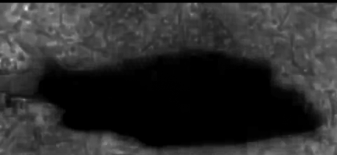
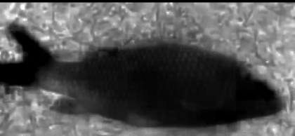
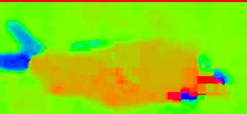
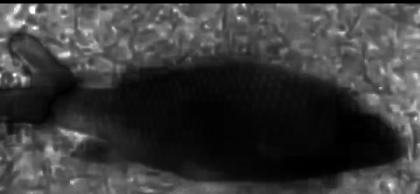
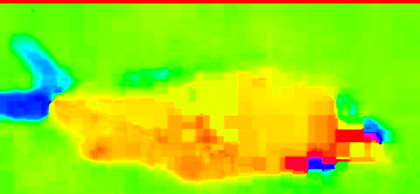
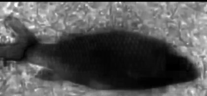

# Tugas 4 - Model Warna

Konversi model warna RGB ke CMYK, HSI, dan HSV beserta konversi baliknya. Semua rumus dihitung manual tanpa `cv2.cvtColor`. Setiap kanal dan hasil rekonstruksi disimpan sebagai gambar kecil terpisah.

## Kode

```python
import os

import cv2
import numpy as np

BASE = os.path.dirname(os.path.abspath(__file__))
IMAGE_PATH = os.path.join(BASE, "crazy.png")


def rgb_to_cmyk(rgb):
    r, g, b = rgb[:, :, 0], rgb[:, :, 1], rgb[:, :, 2]
    k = 1.0 - np.max(rgb, axis=2)

    denom = 1.0 - k
    safe = np.where(denom > 0, denom, 1.0)
    c = (1.0 - r - k) / safe
    m = (1.0 - g - k) / safe
    y = (1.0 - b - k) / safe

    black = denom <= 0
    c[black] = 0.0
    m[black] = 0.0
    y[black] = 0.0
    return np.stack((c, m, y, k), axis=2)


def cmyk_to_rgb(cmyk):
    c, m, y, k = (cmyk[:, :, i] for i in range(4))
    r = (1.0 - c) * (1.0 - k)
    g = (1.0 - m) * (1.0 - k)
    b = (1.0 - y) * (1.0 - k)
    return np.stack((r, g, b), axis=2)


def rgb_to_hsi(rgb):
    r, g, b = rgb[:, :, 0], rgb[:, :, 1], rgb[:, :, 2]
    sumc = r + g + b
    minc = np.min(rgb, axis=2)

    intensity = sumc / 3.0
    safe_sum = np.where(sumc > 0, sumc, 1.0)
    saturation = np.where(sumc > 0, 1.0 - 3.0 * minc / safe_sum, 0.0)

    num = 0.5 * ((r - g) + (r - b))
    den = np.sqrt((r - g) ** 2 + (r - b) * (g - b))
    safe_den = np.where(den > 0, den, 1.0)
    theta = np.arccos(np.clip(num / safe_den, -1.0, 1.0))
    hue = np.degrees(theta)
    hue = np.where(b > g, 360.0 - hue, hue)
    hue = np.where(den > 0, hue, 0.0)

    return np.stack((hue / 360.0, saturation, intensity), axis=2)


def hsi_to_bgr(h, s, i):
    hue = np.mod(h, 1.0) * 360.0
    r = np.zeros_like(hue)
    g = np.zeros_like(hue)
    b = np.zeros_like(hue)

    m = (hue >= 0) & (hue < 120)
    if np.any(m):
        hh = np.deg2rad(hue[m])
        base, sat = i[m], s[m]
        b0 = base * (1.0 - sat)
        r0 = base * (1.0 + sat * np.cos(hh) / np.cos(np.deg2rad(60.0) - hh))
        g0 = 3.0 * base - (r0 + b0)
        r[m], g[m], b[m] = r0, g0, b0

    m = (hue >= 120) & (hue < 240)
    if np.any(m):
        hh = np.deg2rad(hue[m] - 120.0)
        base, sat = i[m], s[m]
        r0 = base * (1.0 - sat)
        g0 = base * (1.0 + sat * np.cos(hh) / np.cos(np.deg2rad(60.0) - hh))
        b0 = 3.0 * base - (r0 + g0)
        r[m], g[m], b[m] = r0, g0, b0

    m = (hue >= 240) & (hue < 360)
    if np.any(m):
        hh = np.deg2rad(hue[m] - 240.0)
        base, sat = i[m], s[m]
        g0 = base * (1.0 - sat)
        b0 = base * (1.0 + sat * np.cos(hh) / np.cos(np.deg2rad(60.0) - hh))
        r0 = 3.0 * base - (g0 + b0)
        r[m], g[m], b[m] = r0, g0, b0

    return np.clip(np.stack((b, g, r), axis=2), 0.0, 1.0)


def rgb_to_hsv(rgb):
    r, g, b = rgb[:, :, 0], rgb[:, :, 1], rgb[:, :, 2]
    maxc = np.max(rgb, axis=2)
    minc = np.min(rgb, axis=2)
    delta = maxc - minc

    safe_max = np.where(maxc > 0, maxc, 1.0)
    safe_delta = np.where(delta > 0, delta, 1.0)

    value = maxc
    saturation = np.where(maxc > 0, delta / safe_max, 0.0)

    h_r = 60.0 * (((g - b) / safe_delta) % 6.0)
    h_g = 60.0 * ((b - r) / safe_delta + 2.0)
    h_b = 60.0 * ((r - g) / safe_delta + 4.0)

    hue = np.where(maxc == r, h_r,
                   np.where(maxc == g, h_g,
                            np.where(maxc == b, h_b, 0.0)))
    hue = np.where(delta > 0, hue, 0.0)
    hue = np.where(hue < 0, hue + 360.0, hue)

    return np.stack((hue / 360.0, saturation, value), axis=2)


def hsv_to_bgr(h, s, v):
    h6 = np.mod(h, 1.0) * 6.0
    sector = np.floor(h6).astype(np.int32) % 6
    f = h6 - np.floor(h6)

    p = v * (1.0 - s)
    q = v * (1.0 - s * f)
    t = v * (1.0 - s * (1.0 - f))

    r = np.select([sector == 0, sector == 1, sector == 2,
                   sector == 3, sector == 4, sector == 5],
                  [v, q, p, p, t, v])
    g = np.select([sector == 0, sector == 1, sector == 2,
                   sector == 3, sector == 4, sector == 5],
                  [t, v, v, q, p, p])
    b = np.select([sector == 0, sector == 1, sector == 2,
                   sector == 3, sector == 4, sector == 5],
                  [p, p, t, v, v, q])
    return np.clip(np.stack((b, g, r), axis=2), 0.0, 1.0)


def channel_to_bgr(channel):
    gray = np.clip(channel * 255.0, 0, 255).astype(np.uint8)
    return cv2.cvtColor(gray, cv2.COLOR_GRAY2BGR)


def rgb_float_to_bgr(rgb):
    bgr = np.clip(rgb[:, :, ::-1] * 255.0, 0, 255).astype(np.uint8)
    return np.ascontiguousarray(bgr)


def bgr_float_to_uint8(bgr):
    return np.clip(bgr * 255.0, 0, 255).astype(np.uint8)


def resize_width(img, width):
    h, w = img.shape[:2]
    return cv2.resize(img, (width, int(width * h / w)),
                      interpolation=cv2.INTER_AREA)


def show_result(title, filename, img, width=420):
    small = resize_width(img, width)
    cv2.imwrite(os.path.join(BASE, filename), small)
    cv2.imshow(title, small)
    cv2.waitKey(0)
    cv2.destroyAllWindows()


def main():
    bgr = cv2.imread(IMAGE_PATH)
    if bgr is None:
        raise FileNotFoundError(f"Gambar tidak ditemukan: {IMAGE_PATH}")

    rgb = bgr[:, :, ::-1].astype(np.float32) / 255.0
    original = bgr.copy()

    cmyk = rgb_to_cmyk(rgb)
    cmyk_back = cmyk_to_rgb(cmyk)
    c, m, y, k = (cmyk[:, :, i] for i in range(4))

    hsi = rgb_to_hsi(rgb)
    hsi_back = hsi_to_bgr(hsi[:, :, 0], hsi[:, :, 1], hsi[:, :, 2])
    h_hsi, s_hsi, i_hsi = (hsi[:, :, i] for i in range(3))

    hsv = rgb_to_hsv(rgb)
    hsv_back = hsv_to_bgr(hsv[:, :, 0], hsv[:, :, 1], hsv[:, :, 2])
    h_hsv, s_hsv, v_hsv = (hsv[:, :, i] for i in range(3))

    hue_hsi_color = bgr_float_to_uint8(
        hsi_to_bgr(h_hsi, np.ones_like(h_hsi), np.full_like(h_hsi, 0.5)))
    hue_hsv_color = bgr_float_to_uint8(
        hsv_to_bgr(h_hsv, np.ones_like(h_hsv), np.ones_like(h_hsv)))

    yy, xx = np.unravel_index(np.argmax(hsv[:, :, 1]), hsv.shape[:2])
    print("Contoh piksel (paling jenuh) pada (x=%d, y=%d):" % (xx, yy))
    print("  RGB  :", np.round(rgb[yy, xx] * 255).astype(int))
    print("  CMYK : C=%.3f M=%.3f Y=%.3f K=%.3f" %
          (c[yy, xx], m[yy, xx], y[yy, xx], k[yy, xx]))
    print("  HSI  : H=%.1f derajat S=%.3f I=%.3f" %
          (h_hsi[yy, xx] * 360.0, s_hsi[yy, xx], i_hsi[yy, xx]))
    print("  HSV  : H=%.1f derajat S=%.3f V=%.3f" %
          (h_hsv[yy, xx] * 360.0, s_hsv[yy, xx], v_hsv[yy, xx]))

    err_cmyk = np.abs(cmyk_back - rgb).mean() * 100.0
    err_hsi = np.abs(hsi_back[:, :, ::-1] - rgb).mean() * 100.0
    err_hsv = np.abs(hsv_back[:, :, ::-1] - rgb).mean() * 100.0
    print("Rata-rata error konversi balik (%%): "
          "CMYK=%.4f HSI=%.4f HSV=%.4f" % (err_cmyk, err_hsi, err_hsv))

    show_result("CMYK - Original", "hasil-cmyk-original.png", original)
    show_result("CMYK - Cyan", "hasil-cmyk-c.png", channel_to_bgr(c))
    show_result("CMYK - Magenta", "hasil-cmyk-m.png", channel_to_bgr(m))
    show_result("CMYK - Yellow", "hasil-cmyk-y.png", channel_to_bgr(y))
    show_result("CMYK - Key / Black", "hasil-cmyk-k.png", channel_to_bgr(k))
    show_result("CMYK -> RGB", "hasil-cmyk-rgb.png",
                rgb_float_to_bgr(cmyk_back))

    show_result("HSI - Original", "hasil-hsi-original.png", original)
    show_result("HSI - Hue", "hasil-hsi-h.png", hue_hsi_color)
    show_result("HSI - Saturation", "hasil-hsi-s.png", channel_to_bgr(s_hsi))
    show_result("HSI - Intensity", "hasil-hsi-i.png", channel_to_bgr(i_hsi))
    show_result("HSI -> RGB", "hasil-hsi-rgb.png",
                bgr_float_to_uint8(hsi_back))

    show_result("HSV - Original", "hasil-hsv-original.png", original)
    show_result("HSV - Hue", "hasil-hsv-h.png", hue_hsv_color)
    show_result("HSV - Saturation", "hasil-hsv-s.png", channel_to_bgr(s_hsv))
    show_result("HSV - Value", "hasil-hsv-v.png", channel_to_bgr(v_hsv))
    show_result("HSV -> RGB", "hasil-hsv-rgb.png",
                bgr_float_to_uint8(hsv_back))


if __name__ == "__main__":
    main()
```

## CMYK

`K = 1 - max(R,G,B)`, `C = (1-R-K)/(1-K)`, begitu pula M dan Y.

### Original (RGB)


### Cyan



### Magenta


### Yellow



### Key / Black


### CMYK -> RGB


## HSI

`I = (R+G+B)/3`, `S = 1 - 3min(R,G,B)/(R+G+B)`, hue memakai rumus cosinus. Hue ditampilkan berwarna agar jenis warnanya terlihat.

### Original (RGB)


### Hue



### Saturation



### Intensity


### HSI -> RGB


## HSV

`V = max(R,G,B)`, `S = (max-min)/max`, hue berdasarkan kanal maksimum. Konversi balik HSV ke RGB menghasilkan citra yang sama.

### Original (RGB)


### Hue



### Saturation



### Value


### HSV -> RGB


