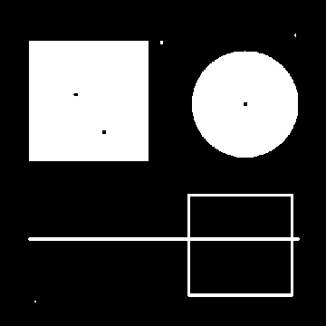
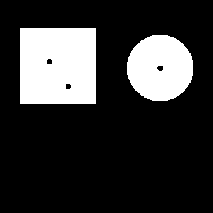
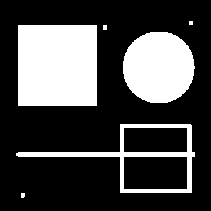
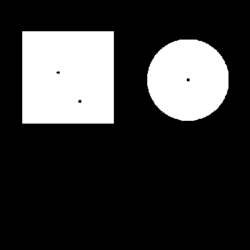
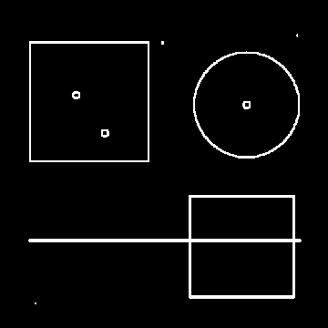

# Tugas 5 - Morfologi Citra

Implementasi manual operasi morfologi biner tanpa `cv2.erode`, `cv2.dilate`, atau `cv2.morphologyEx`, menggunakan structuring element persegi 7x7. Setiap operasi disimpan sebagai gambar kecil terpisah.

## Kode

```python
import cv2
import numpy as np

SE = np.ones((7, 7), dtype=np.uint8)

def erode(binary, se):
    h, w = binary.shape
    kh, kw = se.shape
    ph, pw = kh // 2, kw // 2

    padded = np.pad(binary > 0, ((ph, ph), (pw, pw)), constant_values=False)
    out = np.ones((h, w), dtype=bool)

    for i in range(kh):
        for j in range(kw):
            if se[i, j]:
                out &= padded[i:i + h, j:j + w]

    return out.astype(np.uint8) * 255

def dilate(binary, se):
    h, w = binary.shape
    kh, kw = se.shape
    ph, pw = kh // 2, kw // 2

    padded = np.pad(binary > 0, ((ph, ph), (pw, pw)), constant_values=False)
    out = np.zeros((h, w), dtype=bool)

    for i in range(kh):
        for j in range(kw):
            if se[i, j]:
                out |= padded[i:i + h, j:j + w]

    return out.astype(np.uint8) * 255

def opening(binary, se):
    return dilate(erode(binary, se), se)

def closing(binary, se):
    return erode(dilate(binary, se), se)

def build_image(size=520):
    img = np.zeros((size, size), dtype=np.uint8)

    cv2.rectangle(img, (45, 65), (235, 255), 255, -1)
    cv2.circle(img, (390, 165), 85, 255, -1)
    cv2.line(img, (45, 380), (475, 380), 255, 3)
    cv2.rectangle(img, (300, 310), (465, 470), 255, 4)

    cv2.circle(img, (120, 150), 3, 0, -1)
    cv2.circle(img, (165, 210), 3, 0, -1)
    cv2.circle(img, (390, 165), 3, 0, -1)

    cv2.circle(img, (470, 55), 2, 255, -1)
    cv2.circle(img, (55, 480), 2, 255, -1)
    cv2.rectangle(img, (255, 65), (259, 69), 255, -1)

    return img

def add_salt_noise(img, n=250, seed=7):
    rng = np.random.default_rng(seed)
    out = img.copy()
    h, w = img.shape
    ys = rng.integers(0, h, n)
    xs = rng.integers(0, w, n)
    out[ys, xs] = 255
    return out
```

Kode di atas hanya bagian pengolahan citra. Bagian pembacaan, penampilan, dan penyimpanan hasil beserta nama file output tidak ditampilkan. Kode lengkap ada di `5-morphology.py`.

## Hasil Morfologi

### Original

Citra biner sintetis berisi objek, garis tipis, lubang kecil, dan noise kecil.



### Erosi 7x7

Objek mengecil, garis tipis dan noise kecil hilang.



### Dilasi 7x7

Objek membesar dan lubang ikut menyempit.



### Opening

Erosi lalu dilasi: noise dan objek kecil hilang, objek besar kembali ke ukuran semula.



### Closing

Dilasi lalu erosi: lubang kecil di dalam objek tertutup.


### Boundary

Batas objek dari citra asli dikurangi hasil erosi.



### Noisy (salt)

Citra asli ditambah noise titik putih.


### Opening (noisy)

Noise titik putih dihilangkan oleh opening.


